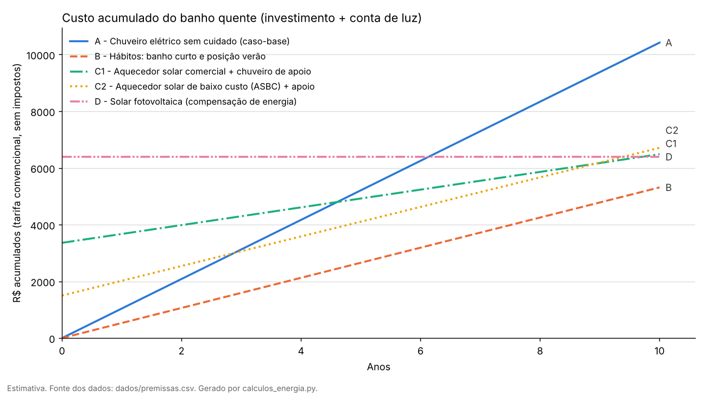

# Citizen Assist AI - Energia: o banho quente na conta de luz

**Contribuição da disciplina Soluções em Energias Renováveis e Sustentáveis**
Global Solution 2026.2 - FIAP - Ciência da Computação (1CC)

| Integrante | RM |
|---|---|
| Gustavo Zibini Belizario | 561376 |

Trabalho individual. Esta pasta (`energia/`) é a parte de Energia do repositório compartilhado do Citizen Assist AI. Tudo o que está aqui é desta disciplina.

---

## 1. Público e problema

**Público:** famílias de baixa renda da cidade de São Paulo, atendidas pela Enel SP, muitas inscritas no CadÚnico.

**Necessidade energética:** água quente para o banho. Na maioria dessas casas a água é aquecida por **chuveiro elétrico**, um aparelho de alta potência (cerca de 5.500 W em 127 V). Ele fica ligado pouco tempo, mas pesa muito na conta.

**Problema:** a família não sabe quanto o banho custa, o que dá para fazer sem gastar e se vale a pena investir em aquecimento solar. Também é comum não saber da Tarifa Social ou achar que ela zera a conta.

**Como o assistente ajuda:** responde em frases curtas quanto o banho gasta, quanto se economiza com hábitos, quanto custa e em quanto tempo se paga um aquecedor solar, quem tem direito à Tarifa Social e quanto CO2 se evita. Uma calculadora faz as contas para o caso da pessoa. Toda resposta mostra a fonte e avisa que é uma estimativa.

## 2. Funcionalidades de energia no assistente

`assistente_energia.py` oferece:

- `responder(pergunta)`: texto livre. Identifica o assunto por palavras-chave (sem IA generativa).
- `executar_menu()`: menu numerado, usado só com o teclado.

| Opção | O que faz |
|---|---|
| 1 | Quanto gasta o chuveiro elétrico (kWh e R$ por mês e por ano) |
| 2 | Como economizar sem gastar (banho mais curto, posição verão) |
| 3 | Vale a pena aquecedor solar (comercial e de baixo custo) |
| 4 | Energia solar fotovoltaica: por que é menos viável para esse público |
| 5 | Tarifa Social: regra atual e quem tem direito |
| 6 | CO2 evitado por alternativa |
| 7 | Calculadora: moradores, minutos de banho, posição ou potência do chuveiro e se tem Tarifa Social |
| 8 | Pergunta com as próprias palavras |
| 9 | Fontes e limitações |

Cuidados implementados:

- Os números das respostas vêm de `calculos_energia.py`. Nenhum número de resultado é digitado no texto.
- Toda resposta tem a fonte (códigos F1 a F14 de `dados/FONTES.md`) e o aviso: estimativa, sem garantia de economia, protótipo educacional, não é canal oficial.
- Entradas inválidas (vazio, texto sem sentido, número negativo ou absurdo, texto com mais de 300 caracteres, assunto fora do escopo) recebem mensagem amigável, sem erro técnico.
- O assistente não pede nem guarda dados pessoais. Se a pessoa digitar algo parecido com CPF, telefone, e-mail ou número longo (conta de luz), ele avisa para não informar e não repete o dado.

## 3. Como executar e testar

Requisito: Python 3.10 ou mais novo. Só biblioteca padrão. O `matplotlib` é opcional (só para o gráfico).

```bash
cd energia
python3 calculos_energia.py      # refaz a tabela, o gráfico e a tabela deste README
python3 assistente_energia.py    # abre o menu do assistente
python3 testes_energia.py -v     # roda os 29 testes automáticos
```

Uso por outro módulo do Citizen Assist AI (a partir da raiz do repositório):

```python
from energia.assistente_energia import responder
print(responder("Quanto gasta o chuveiro?"))
```

Para mudar uma premissa (por exemplo, a tarifa ou o fator de emissão), edite uma linha de `dados/premissas.csv` e rode `python3 calculos_energia.py` de novo. Tabela, gráfico, README e respostas do assistente mudam juntos.

## 4. Estrutura da pasta

```
energia/
├── README.md                  este arquivo
├── calculos_energia.py        fórmulas e tabela comparativa
├── assistente_energia.py      integração com o assistente (responder e menu)
├── testes_energia.py          testes automáticos
├── dados/
│   ├── premissas.csv          todos os dados, com unidade, período, fonte, link e REAL/ESTIMADO
│   └── FONTES.md              lista de fontes F1 a F14 e o que não deu para confirmar
├── resultados/
│   ├── comparacao.csv         tabela comparativa (gerada)
│   ├── comparacao.md          tabela comparativa e sensibilidade (gerada)
│   └── grafico_custo_acumulado.png
├── evidencias/
│   ├── saida_testes.txt       saída real dos testes automáticos
│   └── sessao_assistente.txt  sessão real do menu
├── testes_usuarios/
│   ├── roteiro.md             roteiro para testar com pessoas
│   ├── registro.md            formulário para anotar testes com pessoas
│   ├── teste_simulado.py      teste simulado com 5 personas
│   ├── resultado_simulado_antes_ajuste.csv
│   └── resultado_simulado.csv
├── ROTEIRO_VIDEO.md           roteiro do vídeo de até 3 minutos
└── ENTREGA.txt                modelo do arquivo .txt de entrega
```

## 5. Dados, origem e premissas

A lista completa está em `dados/premissas.csv` (33 premissas, todas com unidade, período, fonte, link, data de acesso 16/11/2026 e a marca REAL ou ESTIMADO). As fontes estão em `dados/FONTES.md`. Resumo dos dados principais:

| Dado | Valor | Marca | Fonte |
|---|---|---|---|
| Potência do chuveiro (127 V, posição mais quente) | 5.500 W | REAL | F4 - manual Lorenzetti Top Jet |
| Redução na posição verão | 30% | ESTIMADO | F5 - Cemig ("chega a 30%"); F4 mostra de 15% a 58% conforme a posição |
| Moradores, banhos por dia, minutos | 4; 1; 10 (hábito: 6) | ESTIMADO | premissas do projeto |
| Tarifa B1 residencial Enel SP (TUSD + TE) | 0,47242 + 0,31696 = 0,78938 R$/kWh | REAL, **sem impostos** | F1 - ANEEL REH 3.596/2026 |
| Tarifa Social: gratuidade | 80 kWh/mês; acima disso, 0,61191 R$/kWh | REAL, sem impostos | F1 (Tabela 3) e F2 |
| Fator de emissão do SIN | 0,0385 kg CO2/kWh (média de 2023) | REAL (via reportagem) | F3 - MCTI |
| Irradiação em São Paulo | 4,589 kWh/m²/dia (inverno 3,784) | REAL | F6 - Atlas Solar do INPE |
| Aquecedor solar comercial 200 L, 2 m², instalado | R$ 3.359,57 | REAL (custo de referência) | F7 - SINAPI 103517 |
| Fração solar do comercial | 70% (mínimo legal 40%) | ESTIMADO | F8 e F9 |
| ASBC para 4 pessoas | R$ 1.500 (fonte: R$ 1.000 a 2.000) | ESTIMADO | F10 |
| Fração solar do ASBC | 50% (fonte divulga cerca de 75%) | ESTIMADO | F10, ajustado para baixo |
| Fotovoltaica 2 kWp | R$ 12.000 (fonte: R$ 10 a 14 mil) | ESTIMADO | F12 |
| Fotovoltaica 4 kWp | R$ 11.360 | REAL (pesquisa de mercado) | F11 - Greener |
| Consumo do resto da casa (só no cenário Tarifa Social) | 100 kWh/mês | ESTIMADO | premissa do projeto |

**Tarifa sem impostos.** Não encontramos em fonte oficial o valor final com ICMS e PIS/Cofins. Por isso todos os custos estão sem impostos e sem bandeira tarifária. Na conta real o kWh custa mais, então os valores em reais aqui são **conservadores**.

## 6. Cálculos e fórmulas

Conceitos usados:

- **Potência (W ou kW):** quanto o aparelho puxa de energia a cada instante.
- **Energia (kWh):** potência vezes tempo. É o que a conta de luz cobra.
- **Eficiência:** quanto da energia vira o resultado desejado. Hábitos e aquecimento solar reduzem a energia elétrica gasta para o mesmo banho.
- **Fração solar:** parte da energia do banho que o sol fornece. O resto vem do chuveiro de apoio.
- **Compensação de energia:** a energia fotovoltaica jogada na rede vira crédito na conta.
- **Fator de emissão:** kg de CO2 emitidos para gerar 1 kWh na rede nacional (SIN).

Fórmulas (todas em `calculos_energia.py`, com comentários e unidades):

| Grandeza | Fórmula | Unidade |
|---|---|---|
| Horas de chuveiro no mês | moradores × banhos/dia × (minutos / 60) × 30 dias | h/mês |
| Energia | E = P × t = (potência em W / 1000) × horas | kWh/mês |
| Custo | energia × tarifa | R$/mês |
| Tarifa Social | (consumo total − 80 kWh, se positivo) × tarifa do excedente | R$/mês |
| Potência média nos hábitos | (P × 0,7 × 6 meses + P × 6 meses) / 12 | W |
| Energia solar útil | menor valor entre (fração solar × demanda) e (área × irradiação × eficiência × 30) | kWh/mês |
| Potência fotovoltaica | energia / (irradiação × 30 × taxa de desempenho 0,75) | kWp |
| Economia | custo de A − custo da alternativa | R$/mês |
| Payback simples | investimento / economia mensal | meses |
| Emissões | energia da rede × fator de emissão | kg CO2 |
| Saldo no horizonte | economia × 120 meses − investimento | R$ em 10 anos |

**Conta à mão do caso-base (A):** 4 pessoas × 1 banho × (10/60) h × 30 dias = 20 h por mês. Energia = 5,5 kW × 20 h = 110 kWh por mês. Custo = 110 × 0,78938 = R$ 86,83 por mês. Emissões = 110 × 12 × 0,0385 = 50,8 kg de CO2 por ano. Essas contas estão escritas e conferidas em `testes_energia.py`.

## 7. Comparação das alternativas

A mesma necessidade (o banho do caso-base) e o mesmo período (mês, ano e 10 anos) para todas as alternativas:

- **A** - chuveiro elétrico usado sem cuidado (caso-base);
- **B** - economia sem investimento: banho de 6 minutos e chave na posição verão nos 6 meses quentes;
- **C1** - aquecedor solar comercial (2 m², 200 L) com o chuveiro como apoio;
- **C2** - aquecedor solar de baixo custo (ASBC) com o chuveiro como apoio;
- **D** - energia solar fotovoltaica com compensação, dimensionada para gerar a energia do banho.

O bloco abaixo é gerado por `calculos_energia.py` (não é digitado à mão):

<!-- TABELA_GERADA_INICIO (não edite: gerado por calculos_energia.py) -->

Necessidade comparada: banho quente de 4 pessoas, 1 banho por pessoa por dia, 10 minutos, chuveiro de 5.500 W, em São Paulo (SP). Período: mês de 30 dias, ano de 12 meses e horizonte de 10 anos.

#### Tabela 1 - Tarifa residencial convencional (0,78938 R$/kWh, sem impostos)

| Alt. | Alternativa | Consumo da rede (kWh/mês) | Consumo (kWh/ano) | Custo (R$/mês) | Custo (R$/ano) | Investimento (R$) | Economia (R$/mês) | Economia (R$/ano) | Payback simples | CO2 evitado (kg/ano) | Saldo em 10 anos (R$) |
|---|---|---:|---:|---:|---:|---:|---:|---:|---|---:|---:|
| A | Chuveiro elétrico sem cuidado (caso-base) | 110,0 | 1.320,0 | 86,83 | 1.041,98 | 0,00 | 0,00 | 0,00 | sem investimento | 0,0 | 0,00 |
| B | Hábitos: banho curto e posição verão | 56,1 | 673,2 | 44,28 | 531,41 | 0,00 | 42,55 | 510,57 | sem investimento | 24,9 | 5.105,71 |
| C1 | Aquecedor solar comercial + chuveiro de apoio | 33,0 | 396,0 | 26,05 | 312,59 | 3.359,57 | 60,78 | 729,39 | 55 meses (4,6 anos) | 35,6 | 3.934,30 |
| C2 | Aquecedor solar de baixo custo (ASBC) + apoio | 55,0 | 660,0 | 43,42 | 520,99 | 1.500,00 | 43,42 | 520,99 | 35 meses (2,9 anos) | 25,4 | 3.709,91 |
| D | Solar fotovoltaica (compensação de energia) | 0,0 | 0,0 | 0,00 | 0,00 | 6.392,10 | 86,83 | 1.041,98 | 74 meses (6,1 anos) | 50,8 | 4.027,72 |

#### Tabela 2 - Família com Tarifa Social (80 kWh gratuitos; excedente a 0,61191 R$/kWh, sem impostos)

Premissa estimada: o resto da casa consome 100 kWh/mês. Assim a gratuidade já é usada pelos outros aparelhos e o banho é todo pago na tarifa do excedente.

| Alt. | Alternativa | Consumo da rede (kWh/mês) | Consumo (kWh/ano) | Custo (R$/mês) | Custo (R$/ano) | Investimento (R$) | Economia (R$/mês) | Economia (R$/ano) | Payback simples | CO2 evitado (kg/ano) | Saldo em 10 anos (R$) |
|---|---|---:|---:|---:|---:|---:|---:|---:|---|---:|---:|
| A | Chuveiro elétrico sem cuidado (caso-base) | 110,0 | 1.320,0 | 67,31 | 807,72 | 0,00 | 0,00 | 0,00 | sem investimento | 0,0 | 0,00 |
| B | Hábitos: banho curto e posição verão | 56,1 | 673,2 | 34,33 | 411,94 | 0,00 | 32,98 | 395,78 | sem investimento | 24,9 | 3.957,83 |
| C1 | Aquecedor solar comercial + chuveiro de apoio | 33,0 | 396,0 | 20,19 | 242,32 | 3.359,57 | 47,12 | 565,40 | 71 meses (5,9 anos) | 35,6 | 2.294,48 |
| C2 | Aquecedor solar de baixo custo (ASBC) + apoio | 55,0 | 660,0 | 33,66 | 403,86 | 1.500,00 | 33,66 | 403,86 | 45 meses (3,7 anos) | 25,4 | 2.538,61 |
| D | Solar fotovoltaica (compensação de energia) | 0,0 | 0,0 | 0,00 | 0,00 | 6.392,10 | 67,31 | 807,72 | 95 meses (7,9 anos) | 50,8 | 1.685,11 |

#### Análise de sensibilidade

- Aquecedor solar comercial com a fração solar mínima da Lei Solar de São Paulo (40%): economia de R$ 34,73 por mês e payback de 97 meses (8,1 anos) (no caso-base: 55 meses (4,6 anos)).
- No inverno a irradiação cai para 3,784 kWh/m2/dia. O coletor comercial de 2,0 m2 capta no máximo 90,8 kWh/mês de calor útil, ou 83% do caso-base. O apoio elétrico é mais usado no inverno.
- Emissões do caso-base: 50,8 kg CO2/ano com o fator de 0,0385 kg CO2/kWh. Com o fator alternativo de 0,0247 kg CO2/kWh seriam 32,6 kg CO2/ano.
- Fotovoltaica: o banho do caso-base pede cerca de 1,07 kWp. Na tabela usamos 6,00 R$/Wp (sistema pequeno, estimado). Com o preço médio de um sistema de 4 kWp (2,84 R$/Wp), o investimento cairia para R$ 3.025,59 e o retorno para 35 meses (2,9 anos). Nos dois casos a compensação tem cobranças mínimas que não entraram no cálculo.
- Fotovoltaica comprando um sistema inteiro de 2 kWp (cerca de R$ 12.000,00, estimado) e pagando só com a economia do banho: retorno em 138 meses (11,5 anos).

#### Observações

- Valores sem ICMS, PIS/Cofins, bandeira tarifária e iluminação pública.
- Tarifa mantida constante no horizonte. Sem custo de manutenção.
- Na alternativa D, o consumo da rede é o líquido depois da compensação (simplificação).
- São estimativas. O resultado real depende do uso, do clima e da instalação.
- Origem de cada número: `dados/premissas.csv` e `dados/FONTES.md`.

<!-- TABELA_GERADA_FIM -->



O gráfico soma o investimento e as contas de luz do banho ano a ano. Onde a linha de uma alternativa cruza a linha A, ela se pagou.

## 8. Justificativa das recomendações

### Custos

- **B (hábitos)** não custa nada e corta cerca de metade do consumo do banho: economia de R$ 42,55 por mês no caso-base. É a única alternativa com retorno imediato e, em 10 anos, a de menor custo acumulado (ver gráfico).
- **C2 (ASBC)** tem o menor investimento entre as fontes renováveis e retorno estimado de 35 meses (2,9 anos) na tarifa comum ou 45 meses (3,7 anos) com Tarifa Social.
- **C1 (solar comercial)** economiza mais por mês (R$ 60,78), mas custa mais: retorno de 55 meses (4,6 anos). Se render só o mínimo da Lei Solar de São Paulo (40%), o retorno passa para 97 meses (8,1 anos).
- **D (fotovoltaica)** é a que mais reduz a conta, mas exige o maior investimento: retorno de 74 meses (6,1 anos) com preço proporcional de sistema pequeno. Comprar um sistema inteiro de 2 kWp só para o banho levaria 138 meses (11,5 anos) para se pagar.
- Hábitos e aquecedor solar podem ser **somados**. A tabela compara cada um sozinho para mostrar o efeito de cada medida.

### Viabilidade prática para o público

| Alternativa | Moradia alugada | Telhado e espaço | Manutenção | Dias nublados e inverno | Viabilidade |
|---|---|---|---|---|---|
| B - hábitos | Funciona | Não precisa | Nenhuma | Banho curto vale sempre; posição verão só nos dias quentes | **Alta** |
| C1 - solar comercial | Depende do dono do imóvel | Telhado com sol (face norte), cerca de 2 m², estrutura para o reservatório cheio | Limpeza das placas, verificar vazamentos | Chuveiro de apoio entra; no inverno o coletor cobre no máximo 83% do banho | Média, para casa própria |
| C2 - ASBC | Depende do dono; pode ser retirado | Laje ou telhado com sol e caixa d'água (funciona em baixa pressão) | Feito pela família; material plástico; durabilidade mínima de 10 anos (F10) | Perde mais calor no frio por não ter vidro; apoio elétrico mais usado | Média a alta, para casa própria com ajuda comunitária |
| D - fotovoltaica | Muito difícil | Telhado próprio e projeto | Limpeza e inversor | Gera menos, mas o crédito é mensal | Baixa para este público |

Por que a fotovoltaica é menos viável aqui: investimento inicial alto, quase não existe sistema tão pequeno quanto o banho pede, precisa de telhado próprio e pedido à distribuidora, a conta continua com cobranças mínimas que os créditos não zeram e, para quem tem Tarifa Social, os primeiros 80 kWh já são gratuitos, então cada crédito vale menos. Para aquecer água, aquecer direto com o sol (C1 ou C2) é mais simples e mais barato.

### Impactos ambientais

- A eletricidade do Brasil é de baixa emissão (fator de 38,5 kg CO2/MWh). Por isso o CO2 evitado pelo banho de uma família é pequeno: de 24,9 a 50,8 kg por ano, conforme a alternativa.
- Mesmo assim, menos consumo no chuveiro alivia a rede no fim da tarde e começo da noite, quando o consumo das casas é alto. A ANEEL usa bandeiras tarifárias quando é preciso ligar térmicas, que emitem mais.
- O ASBC usa material plástico. É preciso descartar corretamente no fim da vida útil.
- O ganho principal para essas famílias é **econômico**. O assistente diz isso com clareza.

### Recomendação que o assistente dá

1. Comece pelos hábitos (B): sem custo e com resultado imediato.
2. Verifique se a família tem direito à Tarifa Social e se o CadÚnico está atualizado.
3. Em casa própria com sol no telhado e caixa d'água, avalie o aquecedor solar: o de baixo custo (C2) pede menos dinheiro; o comercial (C1) economiza mais.
4. A fotovoltaica (D) só faz sentido com telhado próprio e dinheiro para investir; não é a primeira opção para aquecer água.

## 9. Testes

### 9.1 Testes automáticos (feitos)

`testes_energia.py` tem 29 testes em 3 grupos:

1. **Cálculos à mão:** caso-base A, hábitos B, solar C1 e C2, fotovoltaica D e Tarifa Social, com as contas escritas nos comentários.
2. **Entradas inválidas:** vazio, texto longo, texto sem sentido, assunto fora do escopo, CPF, telefone, e-mail, número negativo ou absurdo, menu com entradas erradas e fim de entrada.
3. **Coerência:** cada resposta do assistente é comparada com `resultados/comparacao.csv`; toda resposta tem fonte e aviso.

Resultado: 29 testes, todos passaram. Saída real em `evidencias/saida_testes.txt`. Uma sessão real do menu está em `evidencias/sessao_assistente.txt` (sessão de teste do desenvolvedor, não é teste com usuário).

### 9.2 Testes com usuários: teste simulado com personas

**Testes com pessoas reais não foram realizados** por falta de tempo. No lugar, foi feito um **teste simulado com 5 personas** do público (`testes_usuarios/teste_simulado.py`): cada persona faz as 3 situações do roteiro escrevendo do seu jeito (informal, abreviado, sem acento, com dado pessoal por engano). O assistente real responde e uma regra fixa confere se a resposta tem a informação esperada. O teste mede acerto, tempo de resposta e clareza (palavras por frase); **não mede satisfação nem compreensão**, que só pessoas reais podem informar.

| Persona | S1 - quanto gasta / economizar | S2 - calculadora com o próprio caso | S3 - Tarifa Social / solar |
|---|---|---|---|
| P1 - idosa, pouco uso de celular | "quanto o chuveiro gasta por mes" | "aqui em casa somos 3 e cada um demora uns 12 minutos no banho, quanto da?" | "tenho cadunico, tenho desconto na luz?" |
| P2 - jovem, escreve abreviado | "qnto custa o banho" | "calcular 4 pessoas 8 minutos" | "vale a pena aquecedor solar?" |
| P3 - mãe, quer economizar | "como gastar menos com banho sem comprar nada" | "somos 5 e o banho dura 15 minutos, quanto gasto?" | "o que é tarifa social e quem tem direito" |
| P4 - mora de aluguel | "o chuveiro pesa muito na conta?" | "2 pessoas, banho de 20 minutos, chuveiro 7500 W" | "moro de aluguel, compensa colocar placa solar?" |
| P5 - digita dado pessoal | pergunta com CPF fictício | "calcular meu caso" | "quanto co2 eu evito com aquecedor solar" |

| Indicador | Antes do ajuste | Depois do ajuste |
|---|---|---|
| Acerto geral | 10/15 (67%) | **15/15 (100%)** |
| S2 - calculadora por texto livre | 2/5 | **5/5** |
| S3 - Tarifa Social / solar / CO2 | 3/5 | **5/5** |
| Tempo médio de resposta do sistema | < 1 ms | < 1 ms |
| Palavras por frase (média) | cerca de 10 | cerca de 10 |

| Situação testada | Problema encontrado | Ajuste realizado |
|---|---|---|
| S2 (P1, P3, P4) | Quem escrevia "somos 3... 12 minutos" ou "2 pessoas, banho de 20 minutos" recebia o exemplo genérico de 4 pessoas, porque a calculadora só era acionada com a palavra "calcular". | `responder()` passa a tentar a calculadora sempre que a pergunta tem números, e `calcular_do_texto()` entende "somos N" e "N em casa". Os 29 testes automáticos continuam passando. |
| S3 (P4, P5) | "compensa colocar placa solar?" recebia a resposta do aquecedor solar de água, e "quanto co2 eu evito com aquecedor solar" também, sem falar de CO2. | "placa solar" passa a levar à resposta de energia fotovoltaica, e perguntas com "CO2", "carbono" ou "emissão" vão para a resposta de CO2. |
| S1 (P5) | Nenhum: o CPF foi recusado e não foi usado na resposta. | — |

Resultados: `testes_usuarios/resultado_simulado_antes_ajuste.csv` e `testes_usuarios/resultado_simulado.csv`. O roteiro para pessoas reais continua pronto em `testes_usuarios/roteiro.md`.

## 10. Limitações

- **São estimativas.** Os resultados dependem das premissas. Não há garantia de economia.
- **Sem impostos e sem bandeira:** a tarifa usada é a homologada pela ANEEL sem ICMS e PIS/Cofins.
- **Tarifa constante:** o payback não considera reajustes futuros, inflação nem juros. É payback simples.
- **Hábitos variam:** tempo de banho, número de banhos e uso da posição verão mudam de família para família.
- **Desempenho solar estimado:** a fração solar (70% e 50%) vem de guia, estudo simulado e divulgação, não de medição em São Paulo. A irradiação é média histórica (1995 a 2005).
- **Preços:** o SINAPI é custo médio nacional; o preço do ASBC não tem ano na fonte; o da fotovoltaica pequena vem de reportagem sem origem informada.
- **Sem manutenção:** os custos de manutenção não entraram no cálculo.
- **Fotovoltaica simplificada:** não inclui custo de disponibilidade, regras de compensação da Lei 14.300/2022 nem perdas com o tempo.
- **Fator de emissão:** é a média anual de 2023 conferida por reportagens; a página oficial do MCTI não abriu na pesquisa.
- **Protótipo educacional:** não é canal oficial da Enel, da ANEEL ou do governo. Para pedir a Tarifa Social, a pessoa deve procurar o CRAS e a Enel.

## 11. Referências

Data de acesso de todas: 16/11/2026. Detalhes em `dados/FONTES.md`.

- [F1] AGÊNCIA NACIONAL DE ENERGIA ELÉTRICA (ANEEL). Resolução Homologatória nº 3.596, de 30 de junho de 2026. Enel Distribuição São Paulo. https://www.enel.com.br/content/dam/enel-br/megamenu/para-voc%C3%AA/REH%203596.2026%20Enel%20SP.pdf
- [F2] BRASIL. Secretaria de Comunicação Social. Milhões de famílias de baixa renda já estão sendo beneficiadas com novo desconto social na conta de luz. 06/01/2026. https://www.gov.br/secom/pt-br/acompanhe-a-secom/noticias/2026/01/milhoes-de-familias-de-baixa-renda-ja-estao-sendo-beneficiadas-com-novo-desconto-social-na-conta-de-luz
- [F3] MCTI, fator médio de emissão de CO2 do SIN, citado em: EIXOS. Brasil tem menor taxa de emissão de carbono na geração elétrica em onze anos. https://eixos.com.br/energia-eletrica/brasil-tem-menor-taxa-de-emissao-de-carbono-na-geracao-eletrica-em-onze-anos/ ; e CENÁRIO ENERGIA, 13/06/2025. https://cenarioenergia.com.br/2025/06/13/brasil-reduz-intensidade-de-carbono-na-geracao-eletrica-com-inclusao-de-novas-renovaveis-na-base-de-calculo-oficial/
- [F4] LORENZETTI. Manual do chuveiro Top Jet. https://www.lorenzetti.com.br/manuais/topjet/manual.pdf
- [F5] CEMIG. Eficiência Energética: saiba como economizar energia. 2025. https://www.cemig.com.br/wp-content/uploads/2025/09/Cartilha-Eficiencia-Energetica-Saiba-como-economizar-energia.pdf
- [F6] SÃO PAULO (Estado). Secretaria de Energia. Energia Solar Paulista: levantamento do potencial. 2013 (dados do Atlas Brasileiro de Energia Solar, INPE, 2006). https://www.absolar.org.br/wp-content/uploads/2021/02/S%C3%A3o%20Paulo.pdf
- [F7] SINAPI, composição 103517 e insumo 34472, consultados em Orcamentor. https://orcamentor.com/composicao/103517/ e https://orcamentor.com/insumo/34472/
- [F8] ABRASIP; ABRAVA; ABRINSTAL. Guia e Software de Parametrização da Lei Solar de São Paulo. https://solarthermalworld.org/sites/default/files/Sizing%20tool%20Sao%20Paulo.pdf
- [F9] ALTOÉ, L.; OLIVEIRA FILHO, D.; CARLO, J. C. Análise energética de sistemas solares térmicos para diferentes demandas de água em uma residência unifamiliar. Ambiente Construído, v. 12, n. 3, p. 75-87, 2012. https://seer.ufrgs.br/ambienteconstruido/article/download/25706/21162
- [F10] FUNDAÇÃO BANCO DO BRASIL. Transforma: Aquecedor Solar de Baixo Custo (Sociedade do Sol). https://transforma.fbb.org.br/aquecedor-solar-de-baixo-custo/generate-pdf?id=139
- [F11] CANAL SOLAR. Estudo da Greener sobre geração distribuída, 1º semestre de 2025. 30/09/2025. https://canalsolar.com.br/gd-desempenho-primeiro-semestre-atencao-integradores/
- [F12] OLHAR DIGITAL. Quanto custa instalar energia solar em casa? 17/05/2026. https://olhardigital.com.br/2026/05/17/curiosidades/quanto-custa-instalar-energia-solar-em-casa/
- [F13] ENEL SÃO PAULO. Tarifa de Energia Elétrica. https://www.enel.com.br/pt-saopaulo/Para_Voce/tarifa-energia-eletrica.html
- [F14] DIÁRIO DO PARÁ. Aneel regulamenta a Tarifa Social do Luz do Povo (Lei 15.235/2025). https://diariodopara.com.br/noticias/brasil/aneel-regulamenta-a-tarifa-social-do-luz-do-povo/
